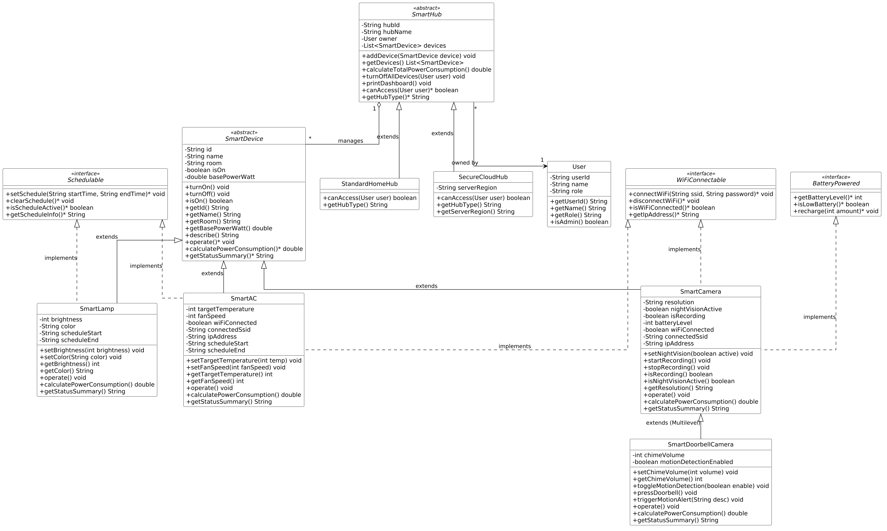

# Smart Home Management System — Case Study on Abstract Classes, Interfaces, Inheritance & Polymorphism

**Author:** THORIQ ABDILLAH FALIAN KUSUMA  
**Student ID (NIM):** F1D02410098  
**Class:** 5A (International Class)  
**Course:** Object-Oriented Programming (OOP)  
**Language:** Java (JDK 11+)

---

## 1. Case Study Overview

The **Smart Home IoT Management System** is a simulation of an integrated smart home ecosystem designed to centrally manage and monitor various automated home appliances and security devices.

- `SmartHub` serves as the central control unit managing multiple `SmartDevice` instances.
- Concrete smart devices supported:
  - `SmartLamp`: Intelligent lighting with brightness adjustment, color selection, and automated scheduling.
  - `SmartAC`: Climate control unit with target temperature setting, fan speed, Wi-Fi connectivity, and operational scheduling.
  - `SmartCamera`: Battery-powered surveillance camera with night vision and video recording capabilities.
  - `SmartDoorbellCamera`: Video doorbell camera featuring a PIR motion detector and a physical chime ring trigger.
- Each device exhibits unique operational behaviors and dynamic power consumption (in Watts).
- Specialized capabilities are assigned cleanly using **Interfaces**:
  - `WiFiConnectable`: Only devices requiring network communication implement this capability.
  - `BatteryPowered`: Only portable/wireless devices implement battery monitoring and recharging.
  - `Schedulable`: Devices supporting timer automation implement scheduling features.

### OOP Concept Mapping Matrix

| OOP Concept | Project Implementation |
|---|---|
| **Abstract Class** | `SmartDevice`, `SmartHub` |
| **Abstract Method** | `SmartDevice.operate()`, `SmartDevice.calculatePowerConsumption()`, `SmartDevice.getStatusSummary()`, `SmartHub.canAccess(User)` |
| **Interface** | `WiFiConnectable`, `BatteryPowered`, `Schedulable` |
| **Single Inheritance** | `SmartLamp extends SmartDevice`, `SmartAC extends SmartDevice`, `SmartCamera extends SmartDevice`, `StandardHomeHub extends SmartHub`, `SecureCloudHub extends SmartHub` |
| **Multilevel Inheritance** | `SmartDevice` $\rightarrow$ `SmartCamera` $\rightarrow$ `SmartDoorbellCamera` |
| **Polymorphism (Runtime Overriding)** | Dynamic execution of `device.operate()`, `device.calculatePowerConsumption()`, and `hub.canAccess(user)` through abstract superclass references |
| **Polymorphism (Interface-Based)** | Collective device handling via `List<BatteryPowered>` and `List<Schedulable>` without concrete type coupling |
| **Encapsulation & Validation** | All fields declared `private`, guarded by `Validator` routines and custom `ValidationException` |

---

## 2. Project Directory Structure

```
case-study-smarthome/
├── README.md                      # Comprehensive academic documentation
├── .gitignore                     # Git ignore rules for build artifacts
├── docs/
│   ├── class-diagram.mmd          # Mermaid UML source code
│   └── class-diagram.png          # High-resolution rendered UML Class Diagram
└── src/smarthome/
    ├── Main.java                  # Main driver demonstrating all OOP principles
    ├── contract/                  # INTERFACES ("Can-Do" Capabilities)
    │   ├── WiFiConnectable.java   # Wireless networking capability
    │   ├── BatteryPowered.java    # Battery management & recharging contract
    │   └── Schedulable.java       # Automation timer & scheduling contract
    ├── exception/                 # Custom Exception
    │   └── ValidationException.java
    ├── validation/                # Data sanitization & invariants
    │   └── Validator.java
    ├── model/                     # DEVICE HIERARCHY
    │   ├── User.java              # System user model (Admin, Member, Guest)
    │   ├── SmartDevice.java       # ABSTRACT CLASS (Base class for all devices)
    │   ├── SmartLamp.java         # implements Schedulable
    │   ├── SmartAC.java           # implements Schedulable, WiFiConnectable
    │   ├── SmartCamera.java       # implements WiFiConnectable, BatteryPowered
    │   └── SmartDoorbellCamera.java # extends SmartCamera (MULTILEVEL INHERITANCE)
    └── hub/                       # HUB & CONTROLLER HIERARCHY
        ├── SmartHub.java          # ABSTRACT CLASS (Central manager)
        ├── StandardHomeHub.java   # Local hub (Open access for household members)
        └── SecureCloudHub.java    # Cloud hub (Strict Admin/Owner role-based access)
```

---

## 3. How to Compile and Run

### On Windows (PowerShell):
```powershell
# 1. Compile all Java source files into the 'out' directory
javac -d out (Get-ChildItem -Recurse src -Filter *.java).FullName

# 2. Execute the main program
java -cp out smarthome.Main
```

### On Linux / macOS (Bash):
```bash
# 1. Compile all Java source files into the 'out' directory
javac -d out $(find src -name "*.java")

# 2. Execute the main program
java -cp out smarthome.Main
```

---

## 4. UML Class Diagram

The rendered high-resolution diagram is available at [`docs/class-diagram.png`](docs/class-diagram.png).



### Structural Relationships:
1. **Device Inheritance Hierarchy:**
   ```
   SmartDevice (abstract)
   ├── SmartLamp (implements Schedulable)
   ├── SmartAC (implements Schedulable, WiFiConnectable)
   └── SmartCamera (implements WiFiConnectable, BatteryPowered)
       └── SmartDoorbellCamera (Multilevel Inheritance)
   ```
2. **Hub Management Hierarchy:**
   ```
   SmartHub (abstract)
   ├── StandardHomeHub
   └── SecureCloudHub
   ```

---

## 5. In-Depth OOP Concepts Explanation

### 5.1 Abstract Classes and Abstract Methods

An **abstract class** is a conceptual blueprint that cannot be directly instantiated with the `new` keyword. It provides shared state and common structure while deferring implementation details to specialized subclasses.

```java
// THIS PRODUCES A COMPILATION ERROR:
SmartDevice device = new SmartDevice("D-01", "Generic Device", "Living Room", 10.0);
// Error: SmartDevice is abstract; cannot be instantiated
```
*Rationale*: In the physical world, a generic "Smart Device" does not exist; only concrete appliances like Lamps, Air Conditioners, and Cameras exist.

`SmartDevice` declares **abstract methods** with no implementation:
```java
public abstract void operate();
public abstract double calculatePowerConsumption();
public abstract String getStatusSummary();
```
* Every subclass **is strictly required to override** these methods. Failure to do so prevents compilation.
* Alongside abstract methods, `SmartDevice` provides **concrete methods** (`turnOn()`, `turnOff()`, and `describe()`) containing shared invariant logic that subclasses inherit without redundancy.

Similarly, `SmartHub` represents another abstract class with an abstract method:
```java
public abstract boolean canAccess(User user);
```
Authorization logic inherently differs between local household networks and secure remote cloud hubs.

---

### 5.2 Interfaces ("Can-Do" Capabilities)

An **interface** establishes a contract of behavior or capability. Any class implementing an interface guarantees the presence of those declared methods.

```java
public interface BatteryPowered {
    int getBatteryLevel();
    boolean isLowBattery();
    void recharge(int amount);
}
```

| Interface | Implemented By | Design Rationale |
|---|---|---|
| `WiFiConnectable` | `SmartAC`, `SmartCamera` | Not all domestic appliances require Wi-Fi connectivity. |
| `BatteryPowered` | `SmartCamera` (and `SmartDoorbellCamera`) | Hardwired devices (AC, Lamp) plug directly into AC mains; only portable surveillance devices manage internal batteries. |
| `Schedulable` | `SmartLamp`, `SmartAC` | Timer automation for power saving and comfort. |

#### Why not place `getBatteryLevel()` in `SmartDevice`?
Placing battery methods inside `SmartDevice` would force `SmartLamp` and `SmartAC` to inherit meaningless battery properties. Using dedicated interfaces enforces the **Interface Segregation Principle (ISP)**.

#### Multiple Interface Implementation
While Java restricts a class to a single superclass (`extends`), it permits multiple interface implementations (`implements`).
Example in `SmartAC`:
```java
public class SmartAC extends SmartDevice implements Schedulable, WiFiConnectable {
    // Inherits base device behavior while satisfying both scheduling and Wi-Fi contracts
}
```

---

### 5.3 Inheritance and Multilevel Inheritance

Inheritance facilitates code reuse and models specialization (*is-a* relationship).

#### Single Inheritance:
`SmartLamp`, `SmartAC`, and `SmartCamera` directly extend `SmartDevice`, inheriting `id`, `name`, `room`, `isOn`, and `basePowerWatt`.

#### Multilevel Inheritance:
Chain: `SmartDevice` $\rightarrow$ `SmartCamera` $\rightarrow$ `SmartDoorbellCamera`.

`SmartDoorbellCamera` is a level-2 subclass. It automatically inherits:
1. All core attributes and state from `SmartDevice`.
2. All surveillance, Wi-Fi, and battery management logic from `SmartCamera`.
3. Introduces domain-specific capabilities: a PIR motion detection sensor and a physical doorbell chime button (`pressDoorbell()`).

```java
public class SmartDoorbellCamera extends SmartCamera {
    public SmartDoorbellCamera(...) {
        super(id, name, room, basePowerWatt, resolution, initialBattery); // Invokes superclass constructor
    }

    public void pressDoorbell() {
        System.out.println("DING-DONG! Doorbell chime activated!");
        startRecording(); // Directly reuses inherited method from SmartCamera
    }
}
```

---

### 5.4 Polymorphism

Polymorphism ("many forms") allows objects of different concrete types to be manipulated through a unified superclass or interface reference, resolving method calls dynamically at runtime (**Dynamic Method Dispatch**).

#### 1. Runtime Superclass Polymorphism:
In `SmartHub.calculateTotalPowerConsumption()`:
```java
double totalWatt = 0.0;
for (SmartDevice device : devices) {
    // Dispatches calculatePowerConsumption() to the concrete runtime instance
    totalWatt += device.calculatePowerConsumption();
}
```
* `SmartLamp`: computes power dynamically scaled to `brightness%`.
* `SmartAC`: factors in cooling load `(30 - temp) * 35.0W` and fan speed.
* `SmartDoorbellCamera`: includes additional continuous standby current for the PIR motion sensor.

#### 2. Interface-Based Polymorphism:
Enables treating disparate objects uniformly according to shared capabilities:
```java
List<BatteryPowered> batteryDevices = List.of(backyardCamera, frontDoorbell);

for (BatteryPowered dev : batteryDevices) {
    if (dev.isLowBattery()) {
        dev.recharge(50); // Recharges any battery-powered unit regardless of device type
    }
}
```

#### 3. Polymorphic Access Verification on `SmartHub`:
```java
List<SmartHub> hubs = List.of(localHub, cloudHub);
for (SmartHub hub : hubs) {
    hub.canAccess(user); // StandardHomeHub permits all users; SecureCloudHub restricts to Admins
}
```

---

### 5.5 Encapsulation and Data Invariant Protection

Encapsulation ensures an object's internal representation remains shielded from illegal outside manipulation.

1. **Private Fields**: All class fields are strictly marked `private`.
2. **Mutator Validation**: State changes pass through guarded setters.
3. **Custom Exception Handling**:
   ```java
   // Attempting to set AC temperature out of safe bounds (allowed: 16 - 30°C)
   bedroomAC.setTargetTemperature(35); 
   // Throws: ValidationException("AC Target Temperature must be between 16 and 30 (given: 35).")
   
   // Attempting to configure lamp brightness to 150% (allowed: 1 - 100%)
   livingRoomLamp.setBrightness(150);
   // Throws: ValidationException("Lamp Brightness must be between 1 and 100 (given: 150).")
   ```

---

## 6. Program Execution Log

```text
===============================================================================================
                   SMART HOME IOT DEVICE MANAGEMENT SYSTEM                                     
             Demonstrating Abstract Class, Interface, Inheritance, & Polymorphism              
===============================================================================================
 Name   : THORIQ ABDILLAH FALIAN KUSUMA
 NIM    : F1D02410098
 Class  : 5A (International Class)
 Course : Object-Oriented Programming (OOP)
===============================================================================================

>>> 1. INITIALIZING SYSTEM USERS
  * Thoriq Abdillah (USR-01 [ADMIN])
  * Falian (USR-02 [MEMBER])
  * Budi Santoso (USR-03 [GUEST])

>>> 2. REGISTERING & INITIALIZING SMART DEVICES
  All devices successfully instantiated with valid parameters.

>>> 3. CONNECTING TO WI-FI NETWORK & CONFIGURING AUTOMATION SCHEDULES
[AC-01] AC connected to Wi-Fi 'Thoriq_Home_5G' with IP: 192.168.1.144.
[CAM-01] Camera streaming online via Wi-Fi 'Thoriq_Home_5G' [IP: 192.168.1.171].
[DBL-01] Camera streaming online via Wi-Fi 'Thoriq_Home_5G' [IP: 192.168.1.152].
[LMP-01] Lamp schedule set: 18:00 to 06:00.
[AC-01] AC schedule set: 21:30 to 05:00.

>>> 4. POWERING ON & EXECUTING DEVICE OPERATIONS
[LMP-01] Lamp 'Living Room Lamp' in Living Room powered ON.
[LMP-01] Living Room Lamp illuminating Living Room with Warm White at 80% brightness.
[AC-01] AC 'Master Bedroom AC' in Bedroom powered ON.
[AC-01] Master Bedroom AC actively cooling Bedroom | Target: 22 C | Fan: Level 3.
[CAM-01] Camera 'Backyard Security Camera' in Backyard powered ON.
[CAM-01] Night Vision mode ENABLED.
[CAM-01] Started recording video feed in 2K QHD to cloud/local storage.
[CAM-01] Backyard Security Camera monitoring Backyard [2K QHD, NightVision: ON, Battery: 18%].
[DBL-01] Camera 'Front Doorbell Camera' in Front Door powered ON.
[DBL-01] Front Doorbell Camera monitoring Front Door [1080p Full HD, NightVision: OFF, Battery: 85%].
   -> [Doorbell Feature] PIR Motion Sensor: ACTIVE | Chime Volume: 8/10.
[ALERT MOTION at Front Door]: Delivery courier detected near the porch!

[DING-DONG!] Front Doorbell Camera chime PRESSED by a visitor! (Vol: 8/10)
>> Sending instant push notification to homeowner's smartphone...
[DBL-01] Started recording video feed in 1080p Full HD to cloud/local storage.

>>> 5. SECOND HIERARCHY DEMONSTRATION: SMARTHUB & ACCESS CONTROL
[Home Local Hub] Device 'Living Room Lamp' (LMP-01) registered to hub.
[Home Local Hub] Device 'Master Bedroom AC' (AC-01) registered to hub.
[Home Local Hub] Device 'Backyard Security Camera' (CAM-01) registered to hub.
[Home Local Hub] Device 'Front Doorbell Camera' (DBL-01) registered to hub.
[AWS Smart Cloud Hub] Device 'Master Bedroom AC' (AC-01) registered to hub.
[AWS Smart Cloud Hub] Device 'Front Doorbell Camera' (DBL-01) registered to hub.

===============================================================================================
SMART HOME DASHBOARD - [Home Local Hub] (Type: Local Standard Hub (Open Access for Household))
Owner: Thoriq Abdillah (USR-01 [ADMIN]) | Total Devices: 4 Units
-----------------------------------------------------------------------------------------------
 * [LMP-01 ] Living Room Lamp     | Room: Living Room  | Status: [ON ] | Power: 9.6W     | Color: Warm White, Brightness: 80% | Schedule [18:00 - 06:00]
 * [AC-01  ] Master Bedroom AC    | Room: Bedroom      | Status: [ON ] | Power: 775.0W   | Temp: 22 C, Fan: Lv3 | WiFi: 192.168.1.144 | Schedule [21:30 - 05:00]
 * [CAM-01 ] Backyard Security Camera | Room: Backyard     | Status: [ON ] | Power: 10.5W    | Res: 2K QHD | Rec: REC | Bat: 18% [LOW!] | WiFi: 192.168.1.171
 * [DBL-01 ] Front Doorbell Camera | Room: Front Door   | Status: [ON ] | Power: 8.7W     | Res: 1080p Full HD | Rec: REC | Bat: 85% | WiFi: 192.168.1.152 | Chime: Lv8 | PIR: ON
-----------------------------------------------------------------------------------------------
TOTAL ESTIMATED POWER CONSUMPTION: 803.80 WATTS
===============================================================================================

>>> ACCESS CONTROL VERIFICATION (POLYMORPHISM):
Access checks on [Home Local Hub]:
   - User 'Thoriq Abdillah ' -> Access: GRANTED
   - User 'Falian          ' -> Access: GRANTED
   - User 'Budi Santoso    ' -> Access: GRANTED
Access checks on [AWS Smart Cloud Hub]:
   - User 'Thoriq Abdillah ' -> Access: GRANTED
   - User 'Falian          ' -> Access: DENIED
   - User 'Budi Santoso    ' -> Access: DENIED

>>> 6. INTERFACE-BASED POLYMORPHISM DEMONSTRATION
[A] Battery-Powered Device Management (List<BatteryPowered>):
   * Backyard Security Camera   | Battery:  18% | Low Warning: CRITICAL (CHARGE NEEDED!)
     --> Triggering automatic recharge for Backyard Security Camera...
[CAM-01] Camera battery recharged (+50%). Current battery: 68%.
   * Front Doorbell Camera      | Battery:  85% | Low Warning: Normal

[B] Automated Schedule Management (List<Schedulable>):
   * Living Room Lamp     -> Schedule [18:00 - 06:00]
   * Master Bedroom AC    -> Schedule [21:30 - 05:00]

>>> 7. ENCAPSULATION & DATA VALIDATION TESTING (EXCEPTION HANDLING)
Attempting out-of-bounds parameter inputs to confirm data integrity safeguards:
  [Test 1] Setting AC temperature to 35 C: REJECTED (Expected) -> AC Target Temperature (C) must be between 16 and 30 (given: 35).
  [Test 2] Setting Lamp brightness to 150%: REJECTED (Expected) -> Lamp Brightness must be between 1 and 100 (given: 150).
  [Test 3] Connecting Wi-Fi with blank SSID: REJECTED (Expected) -> Wi-Fi SSID must not be empty or null.

>>> 8. POLYMORPHIC ROUTINE: CENTRALIZED SHUTDOWN BY ADMIN

>>> Executing 'Turn Off All Devices' routine by Thoriq Abdillah...
[LMP-01] Lamp 'Living Room Lamp' in Living Room powered OFF.
[AC-01] AC 'Master Bedroom AC' in Bedroom powered OFF.
[CAM-01] Camera 'Backyard Security Camera' in Backyard powered OFF.
[DBL-01] Camera 'Front Doorbell Camera' in Front Door powered OFF.
[SUCCESS] All devices in Home Local Hub successfully turned off.

===============================================================================================
SMART HOME DASHBOARD - [Home Local Hub] (Type: Local Standard Hub (Open Access for Household))
Owner: Thoriq Abdillah (USR-01 [ADMIN]) | Total Devices: 4 Units
-----------------------------------------------------------------------------------------------
 * [LMP-01 ] Living Room Lamp     | Room: Living Room  | Status: [OFF] | Power: 0.5W     | Color: Warm White, Brightness: 80% | Schedule [18:00 - 06:00]
 * [AC-01  ] Master Bedroom AC    | Room: Bedroom      | Status: [OFF] | Power: 2.5W     | Temp: 22 C, Fan: Lv3 | WiFi: 192.168.1.144 | Schedule [21:30 - 05:00]
 * [CAM-01 ] Backyard Security Camera | Room: Backyard     | Status: [OFF] | Power: 0.8W     | Res: 2K QHD | Rec: REC | Bat: 68% | WiFi: 192.168.1.171
 * [DBL-01 ] Front Doorbell Camera | Room: Front Door   | Status: [OFF] | Power: 2.0W     | Res: 1080p Full HD | Rec: REC | Bat: 85% | WiFi: 192.168.1.152 | Chime: Lv8 | PIR: ON
-----------------------------------------------------------------------------------------------
TOTAL ESTIMATED POWER CONSUMPTION: 5.80 WATTS
===============================================================================================

[SUCCESS] All OOP concepts for the Smart Home Case Study have been validated successfully!
```

---

## 7. Submission Template for Academic Forum

Copy and paste the template below to submit your assignment:

```text
Subject: 5A_F1D02410098_THORIQ ABDILLAH FALIAN KUSUMA

Message:
[Attach / Upload docs/class-diagram.png]

Repository Link (Public):
https://github.com/ganijack/OOP/tree/main/case%20study%20smart%20home

Brief Explanation:
This case study is titled "Smart Home IoT Device Management System", simulating an integrated smart home ecosystem where an automation hub (SmartHub) oversees and controls diverse appliances such as Smart Lamps, Smart ACs, Surveillance Cameras, and Video Doorbells.

Core OOP Concepts Implemented:
1. Abstract Class & Abstract Method:
   - SmartDevice defines abstract methods: operate(), calculatePowerConsumption(), and getStatusSummary().
   - SmartHub defines abstract methods: canAccess(User) and getHubType().
2. Interface:
   - WiFiConnectable is implemented by SmartAC and SmartCamera.
   - BatteryPowered is implemented by SmartCamera.
   - Schedulable is implemented by SmartLamp and SmartAC.
   This enforces the Interface Segregation Principle, attaching capabilities only where functionally appropriate.
3. Inheritance:
   - Single Inheritance: SmartLamp, SmartAC, and SmartCamera extend SmartDevice; StandardHomeHub and SecureCloudHub extend SmartHub.
   - Multilevel Inheritance: SmartDevice -> SmartCamera -> SmartDoorbellCamera. SmartDoorbellCamera reuses all camera functionalities and adds PIR motion detection plus a physical doorbell chime trigger.
4. Polymorphism:
   - Dynamic Method Dispatch (Runtime): Calling calculatePowerConsumption() and canAccess(User) through superclass references executes subclass-specific logic without instanceof checks.
   - Interface-based Polymorphism: Group management via List<BatteryPowered> and List<Schedulable>.
5. Encapsulation:
   - All properties are declared private. State mutations are guarded by strict boundary validation using a custom Validator class and ValidationException.

Comprehensive code documentation and conceptual walkthroughs are available in the repository README.md.
```
